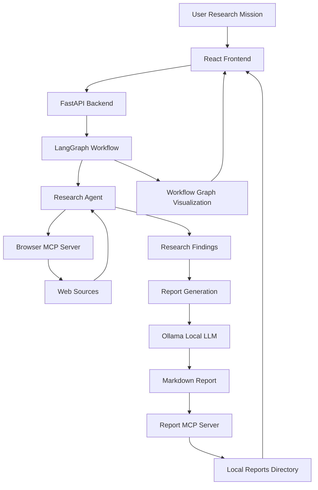

# Aster
### Autonomous Research Workbench

Aster is a local research agent that turns open-ended research missions into structured, source-backed reports. It combines browser-based information retrieval, LLM-driven research, and report generation within an orchestrated workflow.

The system includes a graph visualization that makes the research process observable, allowing users to understand the stages of execution and follow the agent's progress.

> **Status:** Local development. Not deployed.

---

## Overview

Research often involves navigating multiple sources, extracting relevant information, and synthesizing findings into a coherent document.

Aster explores this process through an autonomous research workflow. Given a research mission, it uses browser tools to gather information, processes the findings with a local language model, and generates a Markdown report.

The workflow is represented as a graph, providing visibility into the individual stages involved in completing a research task.

## Features

- **Autonomous research:** Execute research missions using a browser-enabled agent.
- **Local inference:** Run language model inference through Ollama without depending on a hosted LLM API.
- **Tool integration:** Expose browser and report operations through MCP servers.
- **Workflow visualization:** Inspect the research pipeline through a graph-based interface.
- **Report generation:** Synthesize research findings into Markdown documents.
- **Local report storage:** Save generated reports in the project's `reports/` directory.
- **API interface:** Submit research missions through a FastAPI endpoint.
- **Interactive frontend:** Initiate research and view the generated output through a web interface.

## Architecture

Aster is organized around a graph-orchestrated research pipeline.



### Components

| Component | Responsibility |
|---|---|
| React + Vite | Frontend interface |
| React Flow | Graph-based workflow visualization |
| FastAPI | HTTP API for research requests |
| LangGraph | Workflow orchestration |
| Ollama | Local LLM inference |
| Browser MCP Server | Browser-based research tools |
| Report MCP Server | Report persistence and retrieval |

### Workflow

1. A user submits a research mission through the frontend.
2. The frontend sends the request to the FastAPI backend.
3. LangGraph initiates the research workflow.
4. The research agent uses browser MCP tools to retrieve relevant information.
5. The collected findings are passed to the report-generation stage.
6. Ollama generates a structured Markdown report.
7. The report MCP server saves the output locally.
8. The frontend displays the research output and workflow visualization.

---

## Local Setup

Aster is currently intended to run locally. The following setup uses macOS and Ollama for local model inference.

### Prerequisites

- Python 3.11 or a compatible Python version
- Node.js and npm
- Ollama
- Git
- A machine capable of running the selected local model

The model's performance and inference time depend on the available memory and hardware.

### 1. Clone the repository

```bash
git clone <YOUR_REPOSITORY_URL>
cd webpilot
```

### 2. Set up the local language model

Install Ollama from:

https://ollama.com

Start Ollama and pull the model:

```bash
ollama pull qwen3:4b
```

Run the model:

```bash
ollama run qwen3:4b
```

Ollama serves its local API at:

```text
http://localhost:11434
```

Keep Ollama running while using Aster.

### 3. Set up the Python environment

Create a virtual environment:

```bash
python3 -m venv .venv
```

Activate it:

```bash
source .venv/bin/activate
```

Install the Python dependencies:

```bash
pip install -r requirements.txt
```

If the project does not yet contain a `requirements.txt`, install the dependencies listed in the project configuration.

### 4. Configure the MCP servers

Aster uses the Model Context Protocol (MCP) to expose external tools to the research workflow.

The project includes:

- `mcp_server.py` — browser-related research tools
- `report_server.py` — report storage and retrieval tools

The MCP servers are intended to be launched by the MCP client configured in the application.

For a local stdio-based MCP setup, the server configuration should point to the Python interpreter inside the project's virtual environment and the appropriate server script.

Example configuration structure:

```json
{
  "mcpServers": {
    "webpilot-browser": {
      "command": "/absolute/path/to/webpilot/.venv/bin/python",
      "args": [
        "/absolute/path/to/webpilot/mcp_server.py"
      ]
    },
    "webpilot-report": {
      "command": "/absolute/path/to/webpilot/.venv/bin/python",
      "args": [
        "/absolute/path/to/webpilot/report_server.py"
      ]
    }
  }
}
```

Replace the example paths with the absolute paths on your machine.

The MCP client configuration must match the transport and initialization method used by the application.

### 5. Start the backend

From the project root:

```bash
uvicorn api:app --reload --port 8000
```

The API will be available at:

```text
http://localhost:8000
```

Interactive API documentation:

```text
http://localhost:8000/docs
```

The research endpoint is:

```http
POST /api/research
```

Example request:

```json
{
  "mission": "Research the official Python website. Explain what Python is, list three applications, and identify three popular Python libraries."
}
```

### 6. Start the frontend

Open a separate terminal:

```bash
cd frontend
npm install
npm run dev
```

Vite will provide a local development URL, typically:

```text
http://localhost:5173
```

Open the URL in your browser to interact with Aster.

### 7. Run a research mission

Submit a research task through the frontend.

Example:

```text
Research the official NASA website.

Explain what the James Webb Space Telescope is,
when it was launched, and list three important
discoveries made by the telescope.

Generate a concise research report with source links.
```

The workflow will execute through the backend, and the generated Markdown report will be saved locally.

---

## Project Structure

```text
webpilot/
│
├── frontend/
│   ├── src/
│   │   ├── App.jsx
│   │   └── ...
│   ├── package.json
│   └── ...
│
├── reports/
│   └── research_*.md
│
├── api.py
├── webpilot_graph_simple.py
├── mcp_server.py
├── report_server.py
│
├── requirements.txt
└── README.md
```

The structure above represents the main application components. Additional files may be present depending on the local configuration.

---

## Design Notes

Aster is built around the idea that autonomous research should be inspectable rather than opaque.

The graph visualization provides a representation of the workflow, making it easier to understand how a research mission progresses through the system.

The use of local inference and MCP-based tool interfaces also allows the application to be developed and experimented with without requiring a deployed service.

## Limitations

- The application currently runs locally and is not publicly deployed.
- Research quality depends on the retrieved sources and the capabilities of the local model.
- Local inference can be slower than hosted inference, particularly during report generation.
- Browser research may encounter inaccessible websites, dynamic pages, or incomplete information.
- Generated reports should be reviewed for factual accuracy and source quality.

## Future Work

- Streaming workflow updates to the frontend
- Improved source attribution and citation handling
- More robust report generation
- Downloadable reports
- Persistent research history
- Support for additional research tools and models

---

## License

No license has been specified yet.

